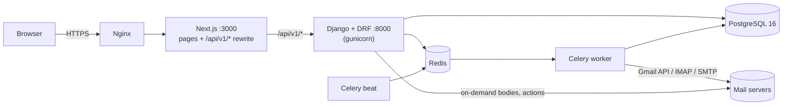
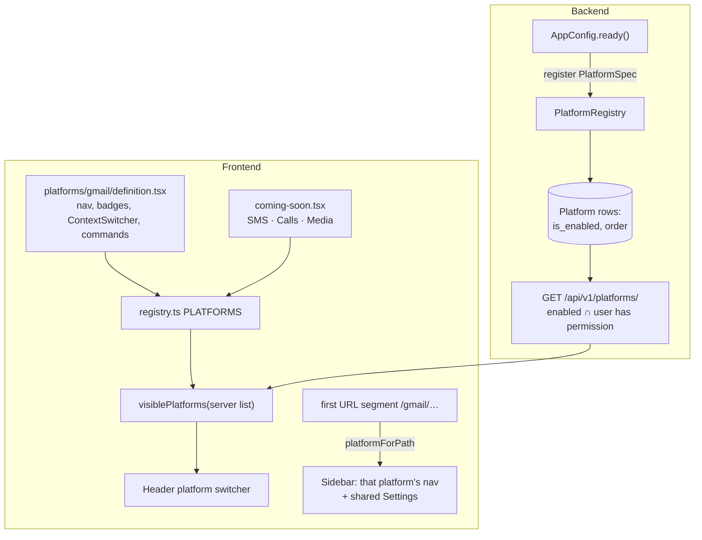
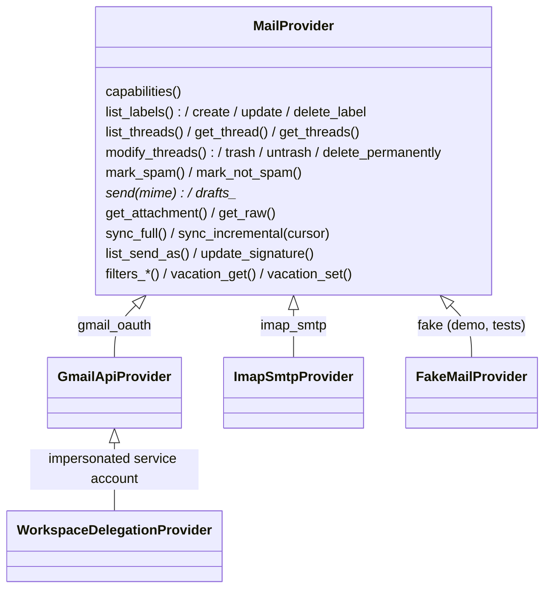
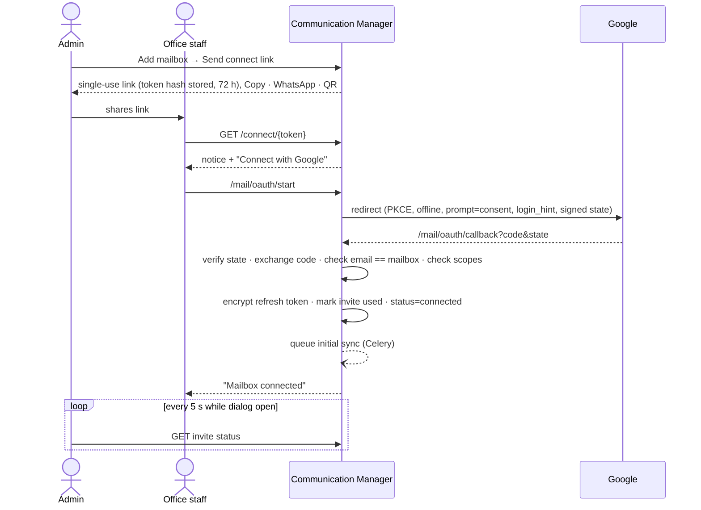
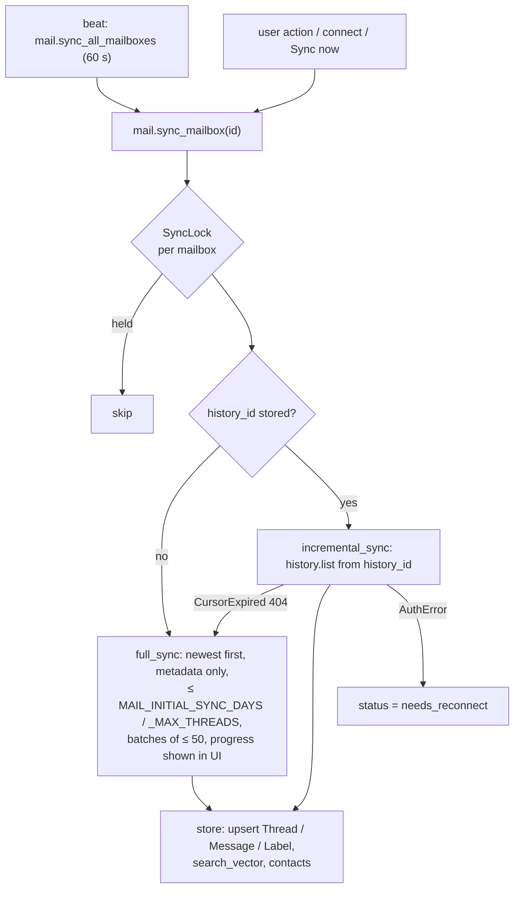

# Architecture

Communication Manager is a Django API (`backend/`) behind a Next.js app (`frontend/`). Each communication
channel is a **platform**. Gmail is the only platform built so far. Inside the Gmail platform, every mail
server is reached through one **provider** interface.

## Request path



- The browser talks only to Next.js. Next.js rewrites `/api/v1/*` to Django, so the session cookie
  (`cm_session`) and CSRF cookie (`cm_csrftoken`) are same-origin and there is no CORS.
- Django holds all state and business logic. Views are thin. Logic lives in `modules/<module>/services/`.
- Celery runs anything slow or delayed: syncs, undo send, scheduled send, snooze wake-ups and body-cache
  eviction. Without `REDIS_URL`, tasks run inline (tests, quick dev).

## Backend modules

| Module | Responsibility |
|---|---|
| `common/` | Error shape (`{code, detail, errors}`), CSRF session auth, cursor pagination, permission helpers, MultiFernet crypto, client IP and throttling |
| `modules/identity` | Email-login `User`, `Role` (on top of Django `Group`), `Office`, login/logout/me, optional TOTP |
| `modules/platforms` | `PlatformRegistry` + `Platform` model (enable, disable and order platforms) |
| `modules/audit` | Append-only `AuditEvent`, list API and CSV export |
| `modules/mail` | The Gmail platform: models, providers, services, API, Celery tasks |

## Platform registry



- **Backend:** a platform is a Django app that registers a `PlatformSpec(key, name, permission,
  default_enabled)` in `AppConfig.ready()`. A `Platform` row stores whether a super admin enabled it and its
  order (**Settings → Platforms**). `GET /api/v1/platforms/` returns the enabled platforms whose permission the
  user has.
- **Frontend:** `src/platforms/registry.ts` lists `PlatformDefinition`s. Each definition owns its sidebar
  sections, badge hook, context switcher (Gmail's mailbox switcher), and ⌘K commands. The header switcher
  shows the intersection of the server list and the code registry. Coming-soon platforms show as disabled
  with a "Soon" badge.
- The active platform is the first URL segment. Switching platforms restores the last route visited in that
  platform (`localStorage`, falling back to the platform home).

See [adding-a-platform.md](adding-a-platform.md). The design was tested by adding a stub SMS platform behind
a flag and then removing it (screenshot `docs/screenshots/desktop-light-sms-stub-proof.png`).

## Provider layer



- `providers/base.py` defines the interface, the data classes (`ProviderThread`, `ProviderMessage`,
  `ChangeSet`, `Capabilities`…) and typed errors: `AuthError` sets the mailbox to `needs_reconnect`,
  `CursorExpired` triggers a full resync, and `Unsupported` covers features a provider lacks.
- `capabilities()` tells the UI what to hide. IMAP has no Gmail filters, categories or server-side vacation.
- Credentials are stored in `Mailbox.encrypted_credentials` (MultiFernet) and decrypted only inside the
  provider.
- `FakeMailProvider` stores its own server state (`FakeMessage`) and history IDs, so the sync engine,
  actions and sends round-trip exactly as they do with Gmail. The demo and the E2E tests run on it.

### Choosing a provider

When an admin adds a mailbox (`services/mailboxes.py` → `detect`):

1. `@gmail.com` / `@googlemail.com` → `gmail_oauth`.
2. Otherwise, look up the domain's MX records (dnspython):
   - Google MX → `workspace_delegation` if the domain has a verified delegation config, else `gmail_oauth`.
   - Microsoft 365 MX → refused with "Microsoft 365 mailboxes are not supported yet."
   - Anything else → `imap_smtp`, prefilled with `mail.<domain>`, 993 / 465 (or 587 STARTTLS).

## Connecting a Google mailbox



A wrong account or a missing scope stores nothing and shows a retry screen. Later, `invalid_grant` or a
revoked token sets `needs_reconnect`, and the UI offers "Send reconnect link".

## Sync flow



- **Bodies** are fetched when a thread opens, sanitised (nh3), cached on `Message.body_html`, and evicted
  after `MAIL_BODY_CACHE_DAYS` by `mail.evict_cached_bodies` (every 6 h).
- **Quota safety:** each mailbox has a token bucket in the shared cache (Redis) (`MAIL_RATE_PER_SECOND`, kept below Gmail's
  per-user limit). Calls back off exponentially with jitter on 429 and `rateLimitExceeded` /
  `userRateLimitExceeded`. API requests never wait on a sync.
- **Actions** (`services/actions.py`) update the local index first, then call the provider. The response
  returns the updated thread summaries, so the client reconciles its optimistic update.
- **Sending:** undo send and schedule send are both `ScheduledEmail` rows. `mail.dispatch_due_sends` (every
  5 s) claims due rows. Cancelling before the claim deletes the row.
- **Push:** Gmail Pub/Sub `users.watch` is not required. A webhook can call `mail.sync_mailbox` later.

## Frontend

```
src/
  app/(auth)/login                 sign-in
  app/(connect)/connect/[token]    public connect page (no shell)
  app/(app)/layout.tsx             shell: sidebar · header (switcher, ⌘K, theme, profile) · content panel
  app/(app)/gmail/…                mail workspace, dashboard, mailboxes, labels, tools
  app/(app)/settings/…             users & roles, offices, platforms, integrations, audit log, preferences
  platforms/registry.ts            PLATFORMS + helpers
  platforms/gmail/                 definition, nav, API hooks, mail components, compose, shortcuts
  components/tailgrids/core        UI primitives (react-aria-components), from the reference design system
  components/shell, components/ui  app shell and shared page patterns (tables, states, cards)
  services/api/                    fetch client (CSRF, ApiError, session-expired event) + generated schema.d.ts
```

- Server state is in TanStack Query. List and thread queries use a `staleTime`. Every mail action is
  optimistic, rolls back on error, and offers undo where it makes sense.
- Long lists are virtualised (`@tanstack/react-virtual`). The 3-pane layout uses `react-resizable-panels`,
  and pane sizes are remembered.
- API types are generated from `contracts/openapi.yaml` (drf-spectacular → openapi-typescript), not written
  by hand.
- User-facing text for the shell and mail lives in `src/i18n/en.ts`, so Swahili can be added later.
