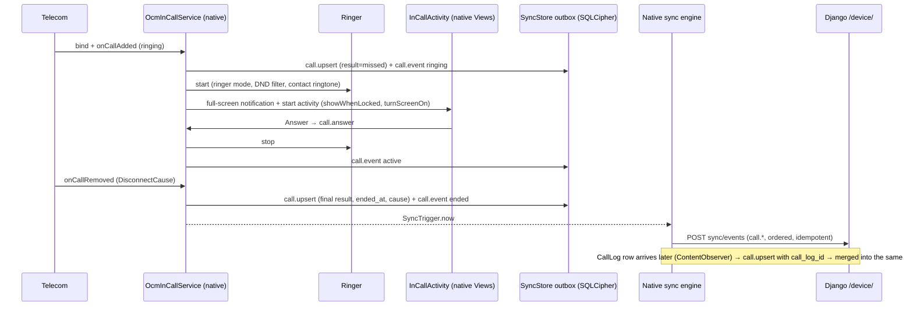

# Calls platform: the dialer on company phones

The Calls platform puts **OCM Phone**, a separate Flutter app, on company Android phones as their **default Phone app**.
Every call the phone makes or receives is copied (number, times, result, SIM; never audio) to OCM, where admins see the
call log, a live board of phones, unreturned missed calls, call-back tasks and analytics. The person holding the phone
talks; the admin never places a carrier call. Admin-initiated calls are **call-back tasks** the staff member places with
one tap. OCM Messages (the SMS app, `mobile/`) is unchanged; a company phone usually runs both.

| Piece | Where |
|---|---|
| OCM Phone app ([README](../mobile_dialer/README.md)) | `mobile_dialer/` |
| Dialer core (Kotlin: InCallService, native call screen, ringer, screening, call log) | `mobile_dialer/android/…/phone/dialer/` |
| Phone screens (Keypad, Recents, Contacts, Call-backs), onboarding, enrollment (Flutter) | `mobile_dialer/lib/features/` |
| Phone identity, enrollment, tokens, heartbeat, push, the event pipeline | `backend/modules/devices/` (shared with SMS) |
| Call records, events, outcomes, annotations, call-backs, settings, rollups, admin + device API | `backend/modules/calls/` |
| Company directory (customers by number, shared by SMS and Calls) | `backend/modules/directory/` |
| Admin UI | `frontend/src/platforms/calls/`, routes under `frontend/src/app/(app)/calls/` |

## Facts that shape the design

- **Two apps, two identities (decision 80).** OCM Phone (`com.kilimanjaro.communicationmanager.phone`) and OCM Messages
  (`…sms`) are separate apps: each has its own enrollment code (`ocmphone://enroll` / `cmsms://enroll`), Keystore key,
  encrypted store, sync engine and device row in the admin (`Device.app`). The admin may link the two devices of one
  handset (`Device.companion`) when creating the OCM Phone code. The automatic missed-call SMS then goes out through
  OCM Messages on that handset. Neither app declares the other's permissions or components.
- **Becoming the default phone app.** The role needs a `DIAL` handler (with and without `tel:`), `VIEW tel:` and an
  `InCallService` bound with `BIND_INCALL_SERVICE`. `OcmInCallService` declares `IN_CALL_SERVICE_UI=true` and
  `IN_CALL_SERVICE_RINGING=true`, so the app draws the call screen and plays the ringtone itself. `DIAL`/`VIEW` only
  pre-fill the keypad. `ACTION_CALL` (dials at once) is a separate alias protected by `CALL_PHONE`, and only an intent
  that arrived through that alias places a call (`Dialer.placesAtOnce`), so an app without that permission cannot dial
  through OCM Phone. Switching Calls off for a phone in the admin only stops the copy; OCM Phone stays a working
  Phone app, also before enrollment and after a revoke (the keypad must always be there).
- **Telecom owns the call log.** Unlike SMS (the app owns the message store), the system writes `CallLog.Calls` for
  every call. The app reads it (`CallLogSync`: one backfill within the enrollment window, then a debounced
  `ContentObserver`) and adds richer live data from `InCallService` callbacks (`CallTracker`). The server merges both
  into one `CallRecord` per call.
- **No call audio.** Since Android 10 no third-party app can capture the voice-call stream, and Play bans
  Accessibility-based recording. v1 records nothing; the legitimate future path is in
  [calls-recording.md](calls-recording.md).
- **The phone holder talks.** No auto-dialing: a call-back task is a notification and a list entry; only a tap on
  *Call* places the call (`origin=callback_task`).

## Emergency calls always work

Nothing in OCM may stand between the keypad and an emergency number:

- `Dialer.place` checks `TelephonyManager.isEmergencyNumber` (errors count as *emergency*). Emergency numbers go
  straight to `TelecomManager.placeCall` without a SIM override and without the `CALL_PHONE` check; if the call is
  still refused, the system dialer is opened with the number.
- Placing a call does not depend on enrollment, the app lock, revocation or the server. The Phone screens are behind
  the enrollment check, but `DIAL`/`VIEW tel:` from any app (the lock-screen emergency button is the system's) go to
  the keypad.
- `OcmCallScreeningService.shouldBlock` never blocks an emergency number, whatever the block list says, and never
  screens outgoing calls.
- Emergency calls are shown, answered and ended like any call but never written: `CallPrivacy.isPrivate` drops them
  before `CallTracker` or `CallLogMapper` produces an event, and the server refuses them too (decision 71).
- Telecom itself binds the system's in-call UI for emergency calls when the default dialer is not a system app, so a
  crash in OCM's call screen cannot strand an emergency call.

Tests: `CallsTest` (Robolectric) covers the emergency path of the tracker, the call-log mapper and screening.

## USSD, MMI and DTMF privacy

- USSD/MMI codes (`*150*00#`, `*#06#`) are placed through `TelecomManager.placeCall`, so Telecom handles MMI and shows
  the operator's response dialog. Anything with `*` or `#` is never tracked, synced, logged or shown in Recents
  (`CallPrivacy.isMmi`). The server refuses such numbers as well.
- DTMF digits typed during a call are drawn on the in-call keypad only; they never reach `CallTracker`, the outbox or
  logs.
- USSD responses (balances, PINs) are rendered by the system dialog; OCM never sees them.

## Incoming call, cold process



The call screen never waits for Flutter (decision 74). Answer, decline, *reply with SMS* (the company's quick
replies from the Calls config; Telecom hands the text to the default SMS app, OCM Messages, which sends it), mute, keypad, audio route (earpiece / speaker / Bluetooth / wired via `CallAudioState`), hold, add call,
merge, swap, end, call waiting and proximity screen-off (`PROXIMITY_SCREEN_OFF_WAKE_LOCK`) are all in
`InCallActivity`. On Android 14+ the full-screen intent needs `canUseFullScreenIntent()`; the onboarding sends the
person to the setting when it is off, and the heartbeat reports it (`fsi_denied`).

### The ringer

With `IN_CALL_SERVICE_RINGING` the app rings (`Ringer`): silent mode → nothing, vibrate mode → vibration only, normal →
ringtone (the contact's own if set) plus vibration when *vibrate when ringing* is on. Do Not Disturb: rings only when
the interruption filter is *all*, or the person's DND settings let this caller through: the system's call filter
(`matchesCallFilter`) on Android 13+, the public policy (calls allowed from anyone / contacts / starred contacts) on
10–12 (decision 76). Answer, decline, the call ending, or a volume key (`onSilenceRinger`) stop it at once. A second call during
a call is call waiting: Telecom plays its tone; OCM does not ring over the conversation.

### Call screening and caller ID

`OcmCallScreeningService` rejects incoming calls from numbers on the phone's block list (shared with SMS and the
admin's *block*) and keeps them out of the ringing UI; the system still logs them as *blocked*. There is no spam
source in v1, so nothing is flagged as spam. Caller identity comes from the phone's contacts first, then the company
directory (`CallerId`: names the server sends for customers this phone has been in contact with, or that an admin
shares with every phone), shown with the label *Company directory*. The directory cache lives in the encrypted
database and is wiped with it on revoke.

## Merging the call log and live events

| Source | Key | Brings |
|---|---|---|
| `CallTracker` (InCallService) | `call_key` (the dialer's own id) | ring/dial start, answer time, end time, disconnect cause, ended by, hold seconds, conference size, origin, call-back task |
| `CallLogMapper` (system call log) | `call_log_id` (`CallLog.Calls._ID`) | final type (missed/rejected/blocked/voicemail/answered elsewhere), duration, presentation, SIM, cached name; also calls the dialer never saw (before enrollment, or made while another dialer was default) |

The server (`modules/calls/services/ingest.py: upsert_call`) finds an existing record by either key, else by number +
start time window + SIM, so a log row and the live events of the same call become one record in either order.
Idempotency is enforced by unique `(device, provider_call_log_id)` and `(device, android_call_key)`. A log row refines
a generic live *missed* (to rejected, blocked, voicemail …) but never overwrites live timestamps. Deleting a row on the
phone does not delete the server copy; it is shown as *deleted on phone*.

## Call-back tasks

```mermaid
sequenceDiagram
  participant A as Admin
  participant D as Django
  participant P as Phone (native engine)
  participant H as Staff member
  A->>D: POST calls/callbacks/ (number, phone, due, reason)
  D-->>P: FCM {"type":"callbacks"} (no content) / next sync cycle
  P->>D: GET device calls/callbacks/
  P->>H: notification "Call back Neema — requested by Halima" (Call / Snooze / Done)
  P->>D: callback.state notified
  H->>P: taps Call
  P->>D: callback.state dialed; call.upsert origin=callback_task, callback_task=<id>
  D->>D: task → dialed; → done when the call connects
```

## Onboarding

First run: enroll (scan the *Enroll OCM Phone* QR, tap the link or type the short code; accept the calls monitoring
notice), then *Set as default Phone app* (`ROLE_DIALER` request; fallback: default-apps settings), call permissions
(`READ_CALL_LOG`, `WRITE_CALL_LOG`, `CALL_PHONE`, `ANSWER_PHONE_CALLS`, `READ_PHONE_STATE`, `READ_PHONE_NUMBERS`,
`READ_CONTACTS`, `WRITE_CONTACTS`, `BLUETOOTH_CONNECT`, `POST_NOTIFICATIONS`), *incoming-call screen* (full-screen
intent, Android 14+) and *keep running in the background*. Steps already done are skipped; each re-checks on return
from the system dialog. A banner on the Phone screens shows when the phone is not enrolled or OCM Phone is not the
Phone app. The heartbeat reports `is_default_dialer`, call permissions, full-screen-intent state and the live call
state; the admin sees `not_default_dialer`, `call_permissions_missing` and `fsi_denied` as attention items.

## Background (decision 81)

OCM Phone keeps no persistent foreground service: during a call Telecom keeps it in the foreground (`phoneCall`) and
the call is uploaded as soon as it ends (expedited WorkManager work). Rows Telecom writes to the call log while the app
is not running start a WorkManager job through a content-URI trigger. A 15-minute periodic job and FCM wake-ups
(`{"type": "callbacks"}`) bring call-back tasks. The monitoring disclosure appears in onboarding, Settings → About, and
on the ongoing-call notification ("Recorded in company call records").

## Phone screens (Flutter)

Keypad / Recents / Contacts / Call-backs, skinned with the same skin system as OCM Messages (`SkinTokens`: key shape and size,
letters, call-button colour, recents row height):

- **Keypad:** T9 search by name words and by number (local `07…` or `+255…`); paste (long-press the number); long-press
  0 for `+`, long-press 1 for voicemail; keys shrink to fit narrow windows.
- **SIM:** one SIM is named on the call (the record carries its line); dual-SIM phones ask, showing the label and colour
  the admin gave each SIM.
- **Recents:** the system call log, grouped by number + missed/not + day, directory names marked; details, call back,
  message (opens the SMS app), add contact, block, delete.
- **Contacts:** the address book with favourites and search; company-directory names marked.
- **Call-backs:** the admin's tasks with Call / Snooze / Done.
- **Post-call card:** outcome chips and an optional note (synced as `call.annotation`); skippable unless the admin made
  it required for calls longer than N seconds.
- **Missed calls:** a notification with *Call back* and *Message*. The automatic missed-call SMS, when the admin turns
  it on, is queued by the server and sent by the phone through the normal SMS path (decision 72).

## Performance budgets

| Budget | Target | Where measured |
|---|---|---|
| Incoming-call screen from a cold process | ≤ 300 ms to first frame | [sms-mobile-performance.md](sms-mobile-performance.md) |
| Recents from cache | ≤ 150 ms | same |
| Keypad search | instant (pure Dart over the cached address book) | unit test |
| APK size | OCM Messages unchanged; OCM Phone ≤ 25 MB per ABI | OCM Phone arm64 release: 14.9 MB |

## Tests

- Kotlin (Robolectric, `NativeSyncEngineTest`): the dialer's sync engine over real HTTP (outbox, tokens, revocation,
  capabilities) never calls an SMS endpoint.
- Kotlin (Robolectric, `CallsTest`): tracker state machine (ringing → active → hold → ended, results per cause),
  call-log mapping, emergency and USSD never recorded, screening never blocks emergency numbers, ringer plan.
- Dart (`test/phone_test.dart`): T9, recents grouping, keypad, voicemail and `+`, dual-SIM choice, redial origin,
  call-back Call/Done, goldens of keypad + recents for every skin in light and dark.
- Backend (`tests/test_calls_*.py`): permission matrix, ingest idempotency and merge, `returns_call`, unreturned
  missed, office hours with time zones and holidays, rollups equal raw aggregation, call-back lifecycle, automatic
  missed-call SMS limits, export masking, emergency/USSD refused, retention.
