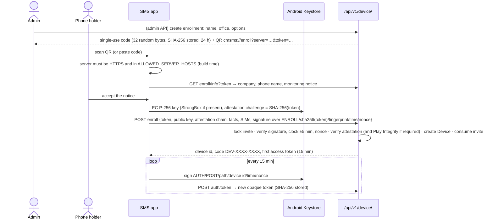
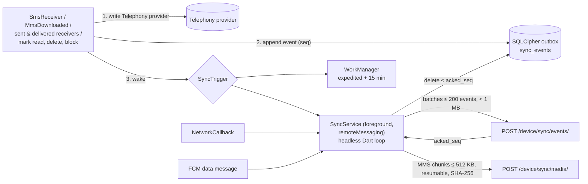
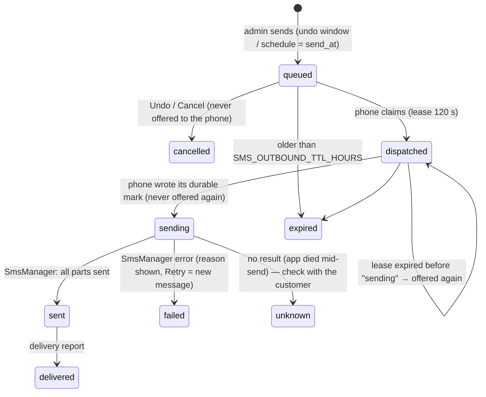

# SMS platform: company phones

The SMS platform copies the text messages of **company-owned Android phones** to Communication Manager and lets
authorised administrators read them and reply. Replies are sent **by the phone, as ordinary carrier SMS** (billed by
the carrier, from the phone's own number). It is not an internet chat app.

| Piece | Where |
|---|---|
| Android app (default SMS app) | `mobile/` (Flutter UI + Kotlin telephony layer) |
| Phone identity, enrollment, tokens, heartbeat, push | `backend/modules/devices/` (shared, Calls will reuse it) |
| Conversations, messages, outbound queue, admin API | `backend/modules/sms/` |
| Admin UI | `frontend/src/platforms/sms/`, routes under `frontend/src/app/(app)/sms/` |

## Facts that shape the design

- **Android only.** iOS lets no third-party app read or send SMS.
- **Default SMS app.** Only the app holding `RoleManager.ROLE_SMS` receives `SMS_DELIVER`/`WAP_PUSH_DELIVER`, may write
  the Telephony provider and gets the SMS permissions without fuss. To be offered as default the app declares the four
  components the role needs (SMS and MMS receivers, the `SEND`/`SENDTO` activity and the respond-via-message service);
  each is guarded by its system permission (`BROADCAST_SMS`, `BROADCAST_WAP_PUSH`, `SEND_RESPOND_VIA_MESSAGE`).
  Every other component is non-exported.
- **We own the message store.** The receiver inserts each incoming SMS into `Telephony.Sms.Inbox`; the sender writes
  the outbox row, then updates it to sent/failed and its delivery status. MMS is downloaded
  (`downloadMultimediaMessage`) and sent (`sendMultimediaMessage`) by the app, with a minimal PDU codec
  (`mms/Pdu.kt`) and a FileProvider path limited to the MMS scratch folder.
- **The customer sees a normal SMS from the phone's number.** "Sent by admin" is shown in the admin and in the app,
  not to the customer — unless the phone's optional admin signature is on (it is appended and counted).
- **Phones kill background apps.** Every event is written to a durable local outbox in the same code path that
  writes the provider, before anything else; uploads resume from there.
- **RCS is out of scope** (Google's RCS is not available to third-party apps).

## Enrollment and identity

- The **device code** (`DEV-7F3K-9Q2M`, Crockford base32) identifies a phone in the admin; it is never a credential.
- No long-lived bearer secret exists on the phone. Tokens live 15 minutes (`SMS_DEVICE_TOKEN_TTL`) and are minted with
  a fresh Keystore signature, a ±5-minute clock window and a never-seen nonce (cache, 10 minutes).
- `SMS_REQUIRE_KEY_ATTESTATION` refuses phones without a hardware-backed, attested key (needs Google's roots in
  `SMS_ATTESTATION_ROOTS_FILE`). `SMS_REQUIRE_PLAY_INTEGRITY` refuses phones that fail Play Integrity; privately
  distributed builds pass only when signed with a certificate listed in `PLAY_INTEGRITY_CERT_DIGESTS`.
- Five failed attempts against one enrollment code revoke it. Every outcome is audited.
- **Suspend** → `403 device_suspended`: the phone keeps everything and retries every 15 minutes. **Revoke** (the admin
  types the device code to confirm) → `401 device_revoked`: the app deletes its key, sync database and settings and
  shows "This phone was removed by your administrator". The phone's own SMS are untouched. Server data stays.
- `SMS_MIN_APP_VERSION`: older apps get `426 upgrade_required` on every request.

## Sync protocol (phone → server)

- Event types: `message.upsert`, `message.read`, `message.delete`, `thread.read`, `thread.delete`, `contact.upsert`,
  `block.add`, `block.remove`, `backfill.progress`.
- **Idempotent:** the server skips sequences it already processed and identifies messages by
  (device, kind, provider `_id`, provider date) or by `client_uuid` for admin messages. Retrying is always safe.
- **Untrusted input:** strict serializers, body ≤ 5 000 characters, ≤ 20 recipients, dates between 2000 and now + 1
  day, batch limits, per-device throttle, and an event can only ever touch its own phone's data (a foreign
  `client_uuid` is rejected). Bad events are rejected *and* acknowledged so they can't block the queue.
- **Backfill:** after enrollment the app copies the last `SMS_INITIAL_SYNC_DAYS` (default 90) newest first; progress
  shows on the phone and on the phone's admin page. "Request resync" in the admin repeats it.
- **Heartbeat** every 5 minutes and on network changes: battery, network, signal, default-app check, permissions,
  battery optimisation, upload backlog, app/Android version, SIMs, root/emulator signals (reported, not blocking).
  The admin shows Online (seen within two heartbeats) or Offline with "last seen", and alerts: offline, not the
  default SMS app, permission revoked, battery optimisation on, upload backlog, app outdated.
- **Contacts are minimised:** names are looked up only for numbers that appear in conversations; the server ignores
  names for any other number.

## Admin reply → phone sends it

1. The admin writes in a conversation (needs `can_send`). The server validates the recipient (no sender IDs; short codes
   and premium-rate numbers refused unless `SMS_ALLOW_SHORT_CODES`), applies the per-user and per-phone rate limits and
   the daily cap (`SMS_DEVICE_DAILY_CAP`, protects the SIM from carrier spam blocks), appends the phone's signature if
   enabled, stores the message encrypted, audits `sms.send` (masked numbers only), and wakes the phone (FCM).
2. **Undo send and scheduled send** both set `send_at` (now + the user's undo seconds, or the chosen time); the phone
   can only claim messages whose `send_at` has passed.
3. The phone claims due messages, checks its own durable table (never send a `client_uuid` twice), records `sending`,
   writes the outbox row, sends on the chosen SIM (default: the SIM the conversation last used, else the phone's
   default) with `divideMessage`/`sendMultipartTextMessage`, and reports each state change.
4. **Offline phone:** the message waits ("Waiting for Arusha front desk to come online — it will be sent
   automatically") in the chat and the Outbox, and expires after `SMS_OUTBOUND_TTL_HOURS` instead of going out days
   late.
5. On the phone, admin messages have their own bubble colour and "Sent by admin · Name"
   (`SMS_SHOW_ADMIN_NAME_ON_PHONE`). They can't be edited (SMS can't be); deleting them locally is reported.

Commands (mark read on open, resync, block/unblock) ride on the same claim and are acknowledged.

## Security summary

- Message bodies, snippets and MMS files are encrypted at rest with `SMS_DATA_KEYS` (MultiFernet, separate from
  `MAIL_TOKEN_KEYS`; production refuses to start without it). `rotate_sms_keys` re-encrypts everything.
- MMS media is served only through `GET /sms/messages/{id}/media/{part}/` after the phone-access check, audited, with
  `nosniff` and a sandboxing CSP. The real type comes from the file's magic bytes, not the phone's claim.
- Object-level access (`DeviceAccess`: read, send, manage, reveal sensitive); anything a user can't read answers 404.
- One-time codes and bank/mobile-money messages are masked ("Verification code ••••••"); revealing needs
  `can_reveal_sensitive` and is audited. The phone's notification offers "Copy code".
- Opening a conversation is audited (`sms.conversation_open`) and marks it read (and, if the phone's option is on,
  on the phone too). `?peek=1` does neither.
- Logs carry ids, counts and masked numbers (`+2557•••••331`), never text, contact names, tokens or full numbers.
- Phone: no backups (`allowBackup=false`, extraction rules exclude everything), no cleartext, SPKI pinning, R8 and Dart
  obfuscation, Keystore keys, SQLCipher database, optional app lock and FLAG_SECURE, lock-screen text hidden by default.

## Retention and PDPA (Tanzania)

- Lawful basis and transparency: the phone holder must accept the company's monitoring notice before enrollment
  (stored with the phone; editable in Settings → Integrations). The app is meant for company-owned phones.
- Purpose and storage limitation: `SMS_RETENTION_DAYS` (default 365) deletes older messages and media from the server.
  Deletions on the phone do not delete the server copy by default (`SMS_MIRROR_DEVICE_DELETES=false`): the copy is
  the company's accountability record and shows "Deleted on phone". Set it to `true` if your policy says otherwise.
- Minimisation: only numbers in conversations are named; the address book is never uploaded; analytics use metadata.
- Accountability: every read, reveal, send, cancel, retry, block, enrollment, suspension, revocation and option
  change is in the append-only audit log.

## Distribution

Google Play restricts SMS permissions to default SMS handlers and requires a Permissions Declaration. Distribute the
app privately: as a **managed Google Play private app** through your EMM, or as a **signed APK pushed by MDM**.
Battery-optimisation exemption (`REQUEST_IGNORE_BATTERY_OPTIMIZATIONS`) is only acceptable for private distribution.
Build, signing, pins and Firebase: [mobile/README.md](../mobile/README.md).

## Without FCM

Firebase is optional. Without `FCM_*` on the server and `google-services.json` in the app, the foreground service
polls every `SMS_DEVICE_POLL_SECONDS` (20 s) while online and WorkManager syncs every 15 minutes. With FCM, admin
replies reach the phone in about a second (data-only messages: `{"type": "outbox", "device": id}`, no content).

## Demo without a phone

`seed_demo` (with `SMS_ENABLE_SIMULATOR=true`, the dev default) creates two simulated phones (one dual-SIM) that enroll
through the real endpoints with a real EC key and upload Swahili/English conversations, M-PESA-style sender IDs,
one-time codes and an MMS photo. On a simulated phone's page the admin can switch it offline/online, process the
outbox and make it receive a text. `python manage.py simulate_sms_device --run` keeps them working (heartbeats,
sending → sent → delivered with realistic delays, occasional new messages; numbers ending in 000 fail).
